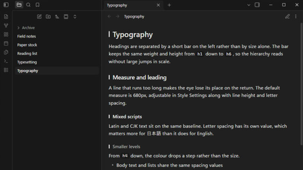
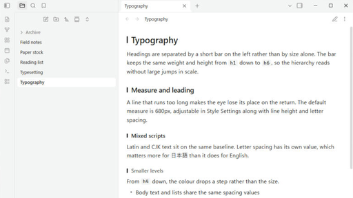

# Sumi

A monochrome theme for Obsidian. Light and dark, with Style Settings support.

Obsidian derives most of its interface colour from `--accent-h / --accent-s / --accent-l`. Sumi sets saturation to 0%, which turns buttons, selection, links, graph nodes and checkboxes grey at once, and then removes the colour that remains.

Colour is kept in two places:

| Kept | Reason |
|---|---|
| Error, warning, success | Grey versions are easy to miss |
| Syntax highlighting | Telling strings, comments and function names apart by weight alone makes code hard to read |

Making something harder to read for the sake of a consistent surface is the wrong trade, so these stay.

## Text size and accent are yours

**Text size is not set by the theme.** Settings → Appearance → Font size applies as it normally does. What the theme defines is the proportions — the difference between headings and body text, line height, spacing — all in `em`, so changing the size does not break them.

**The accent colour is Obsidian's own setting.** Settings → Appearance → Accent color. The default is grey; pick a colour and buttons, selection, focus, and diagram outlines and fills follow it. The theme does not override `--interactive-accent`, because a theme that does makes that setting do nothing.

## What the theme covers

- **Headings** are marked by a short bar on the left rather than by size alone. Reading view and editing view put the bar in the same place, and the collapse arrow has its own lane so the two never overlap.
- **Spacing** between paragraphs, headings and lists is matched between reading and editing view. The two use different mechanisms — margins that collapse, and line padding that does not — so they are driven from one set of values.
- **Tables** do not wrap inside cells. A table that does not fit scrolls sideways instead of breaking words into two or three characters per line. On mobile the table text drops one step so columns stay side by side.
- **Letter spacing** is a separate value. It matters when reading CJK text, and it is adjustable.
- **Mermaid** diagrams are drawn in the theme's colours in both modes, including sequence diagrams, subgraphs and edge labels.
- **Callouts** are drawn in grey and told apart by their icon. Colour can be restored.
- **Canvas** colours and graph nodes are greyscale, separated by lightness.
- **The file tree** reads flat: no indentation guides, the selected row marked by a rounded panel, folders starting with `_` dimmed.

## Install

From Obsidian: Settings → Appearance → Themes → Manage, then search for Sumi.

Manually: download `theme.css` and `manifest.json` from the latest release and put both in `<vault>/.obsidian/themes/Sumi/`.

## Style Settings

The [Style Settings](https://github.com/mgmeyers/obsidian-style-settings) plugin is optional. Without it the theme runs at its defaults — every toggle is written as a switch that changes the default, not one that enables it.

| Group | Options |
|---|---|
| Colour | Editor background / Sidebar background / Text / Keep Mermaid's own colours / Keep callout colours |
| Typography | Line width / Line height / Letter spacing |
| Headings | Plain headings / Marker width / Marker height |
| Interface | Sidebar row height / Indentation guides / Properties heading / Ribbon icon strength / Hide sidebars in a narrow window |

The accent colour is deliberately not here. It belongs to Obsidian's own Appearance settings.

## Compatibility

`minAppVersion` is 1.5.0. The heading bar uses `:nth-child(… of …)`; on older versions the bar does not appear and everything else still works.

## License

MIT. See `LICENSE`.

## Support

Sumi is free. Obsidian changes its internal class names a few times a year, and keeping a theme working means re-testing it and fixing what broke. If Sumi is part of how you read and write every day, you can support that work here:

---

## 日本語

Obsidian 用の無彩色テーマです。ライトとダーク、Style Settings に対応しています。

Obsidian は UI の大半を `--accent-h / --accent-s / --accent-l` から導出します。彩度を 0% にすると、ボタン・選択・リンク・グラフ・チェックボックスまで一度に無彩色になります。そこを出発点にして、残った色を落としてあります。

色を残しているのは**エラー・警告・成功**と**コードのシンタックスハイライト**だけです。前者は無彩色にすると見落とし、後者は文字列・コメント・関数名の区別が太さだけになるとコードが読めなくなるためです。見た目を揃えるために読みにくくするのは本末転倒だと判断しました。

**文字の大きさと、アクセントの色は利用者のものです。** フォントサイズはテーマ側で決めていません（設定 → 外観 → フォントサイズ がそのまま効きます）。アクセントも Obsidian 標準の 設定 → 外観 → アクセントカラー を使います。テーマが `--interactive-accent` を固定すると、その設定が何も効かなくなるためです。

主なところ。

- 見出しは大きさの差ではなく左の短いバーで段を示します。読みモードと編集モードで同じ位置に出て、折りたたみの矢印とも重なりません
- 段落・見出し・リストの余白を、読みモードと編集モードで揃えてあります
- 表のセルは折り返しません。幅が足りない表は、1語が2〜3文字に割れる代わりに横スクロールになります
- 字間が独立した値になっています。日本語を読むときに効きます
- Mermaid の図を、ライトとダークの両方でテーマの色に合わせ直しています
- コールアウトは無彩色で描き、アイコンで種類を見分けます。色は戻せます
- Canvas とグラフのノードは明度だけで段をつけています

導入は、Obsidian の 設定 → 外観 → テーマ → 管理 から Sumi を検索するか、最新リリースの `theme.css` と `manifest.json` を `<vault>/.obsidian/themes/Sumi/` に入れてください。

ライセンスは MIT です。

Obsidian は年に数回、内部のクラス名が変わります。テーマを動かし続けるには、そのたびに確認して直す作業が要ります。Sumi が日々の読み書きの一部になっているなら、[Ko-fi](https://ko-fi.com/frworks) から支援できます。
